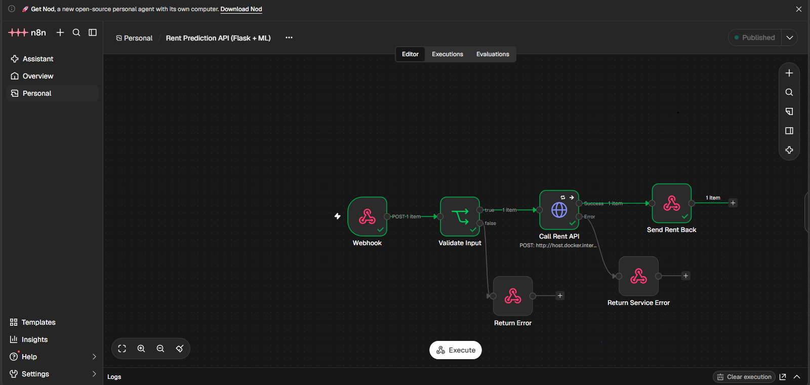

# Rent Predictor: Flask ML API + n8n Workflow

A rent prediction service that connects a machine learning model to an automation workflow. A scikit-learn model is served as a REST API with Flask, and an n8n workflow exposes it through a webhook with input validation and error handling.

Send a property's size and number of rooms to the webhook and get back a predicted rent.

## Demo

n8n workflow:



Test calls (valid request, larger property, invalid input):


## How it works

```
Client (PowerShell / curl / app)
        |
        v
Webhook  (POST /webhook/predict-rent)
        |
        v
Validate Input: are size_sqm and rooms numbers > 0 ?
        |                              |
      true                           false
        |                              |
        v                              v
Call Rent API  ------>           Return Error
(Flask /predict)                 {"error": "size_sqm and rooms
   |         |                    must be numbers greater than 0"}
success    error
   |         |
   v         v
Send Rent    Return Service Error
Back         503 {"error": "Prediction service is unavailable..."}
{"predicted_rent": ...}
```

## Tech stack

- **Python**, **Flask** for the prediction API
- **scikit-learn** and **pandas** for the model
- **n8n** (self-hosted in **Docker**) for the workflow
- **PowerShell** / curl for testing

## What it demonstrates

- Training a regression model and serving it as an API
- Calling an ML API from an n8n workflow
- Input validation with clear error responses
- Error handling when the model service is down (503 response)
- Docker networking: n8n in a container reaching Flask on the host via `host.docker.internal`
- Test vs production webhooks in n8n

## Model

- **Task:** predict rent from property features
- **Inputs:** `size_sqm` (size in square metres) and `rooms` (number of rooms)
- **Algorithm:** Linear Regression (scikit-learn)
- **Training data:** a small sample dataset of 8 homes defined directly in `rent_api.py` (sizes from 20 to 70 sqm, 1 to 4 rooms), created for this demo and not taken from a real listings source

> This is a demo project to show the integration pattern, not a production pricing model. With only 8 training rows, predictions are rough, especially for sizes outside the 20 to 70 sqm range.

## Project structure

```
.
├── rent_api.py                     # Flask API serving the model
├── rent-predictor-workflow.json    # Exported n8n workflow
├── screenshots/                    # Workflow and test screenshots
└── README.md
```

## Prerequisites

- Python 3.9+
- Docker Desktop

## Setup

### 1. Install the Python packages

```bash
python -m pip install flask pandas scikit-learn
```

### 2. Start the Flask API

The server listens on all interfaces so the n8n container can reach it:

```python
app.run(host="0.0.0.0", port=5000)
```

Run it:

```bash
python rent_api.py
```

Check it works directly:

```powershell
Invoke-RestMethod -Uri http://127.0.0.1:5000/predict -Method Post -ContentType "application/json" -Body '{"size_sqm":45,"rooms":3}'
```

### 3. Start n8n in Docker

```bash
docker run -it --rm --name n8n -p 5678:5678 -v n8n_data:/home/node/.n8n n8nio/n8n
```

Open http://localhost:5678 and sign in.

### 4. Import the workflow

In n8n, create a new workflow, open the **...** menu, choose **Import from file** and select `rent-predictor-workflow.json`. Click **Publish** to activate the production webhook.

The Call Rent API node sends requests to the Flask API at:

```
http://host.docker.internal:5000/predict
```

## Usage

Send a POST request to the production webhook:

```
http://localhost:5678/webhook/predict-rent
```

### Example 1: valid request

```powershell
Invoke-RestMethod -Uri http://localhost:5678/webhook/predict-rent -Method Post -ContentType "application/json" -Body '{"size_sqm":45,"rooms":3}'
```

Response:

```json
{ "predicted_rent": 21217 }
```

### Example 2: larger property

```powershell
Invoke-RestMethod -Uri http://localhost:5678/webhook/predict-rent -Method Post -ContentType "application/json" -Body '{"size_sqm":80,"rooms":4}'
```

Response:

```json
{ "predicted_rent": 37938 }
```

This size is above the training range (20 to 70 sqm), so the model extrapolates the trend.

### Example 3: invalid input

```powershell
Invoke-RestMethod -Uri http://localhost:5678/webhook/predict-rent -Method Post -ContentType "application/json" -Body '{"size_sqm":-5,"rooms":3}'
```

Response:

```json
{ "error": "size_sqm and rooms must be numbers greater than 0" }
```

### Example 4: Flask API is down

Stop `rent_api.py`, then send a valid request. The workflow returns HTTP status 503:

```json
{ "error": "Prediction service is unavailable. Please try again later." }
```

For testing while building, use the test URL (click **Execute workflow** in n8n first):

```
http://localhost:5678/webhook-test/predict-rent
```

## Workflow nodes

| Node | Purpose |
| --- | --- |
| Webhook | Receives the POST request |
| Validate Input | Checks that `size_sqm` and `rooms` are numbers greater than 0 |
| Call Rent API | Sends the data to the Flask `/predict` endpoint |
| Send Rent Back | Returns the predicted rent to the caller |
| Return Error | Returns a validation error for bad input |
| Return Service Error | Returns a 503 when the Flask API is unavailable |

Validation expression used in the Validate Input node:

```
{{ Number($json.body.size_sqm) > 0 && Number($json.body.rooms) > 0 }}
```

## Limitations

- Runs locally: Docker and Flask must both be running for the workflow to work.
- The model is trained on only 8 sample rows and two features, so predictions are approximate.
- Inputs outside the training range (20 to 70 sqm) are extrapolated and less reliable.
- No authentication on the webhook, so this is for local demos only.

## Possible improvements

- Train on a real rent dataset with more features (location, bathrooms, property type) and compare models
- Deploy the Flask API to a free host (for example Render) so the demo is live
- Secure the webhook with header authentication
- Send an email alert when the prediction service fails
- Apply the same pattern to a healthcare use case, such as a post-operative risk score

## Author

**Hope Mutheu**
LinkedIn: https://www.linkedin.com/in/hope-mutheu-3751a842a
